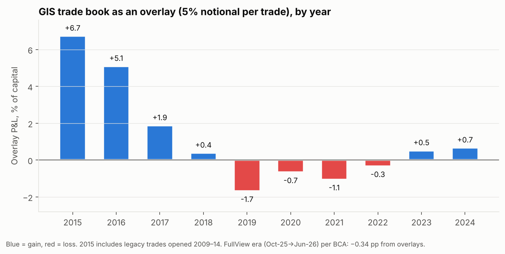
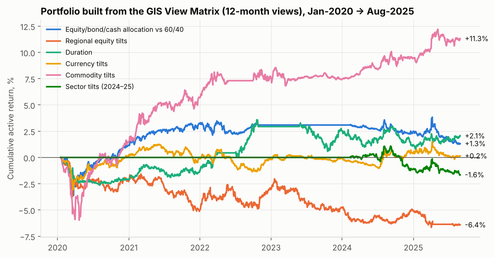
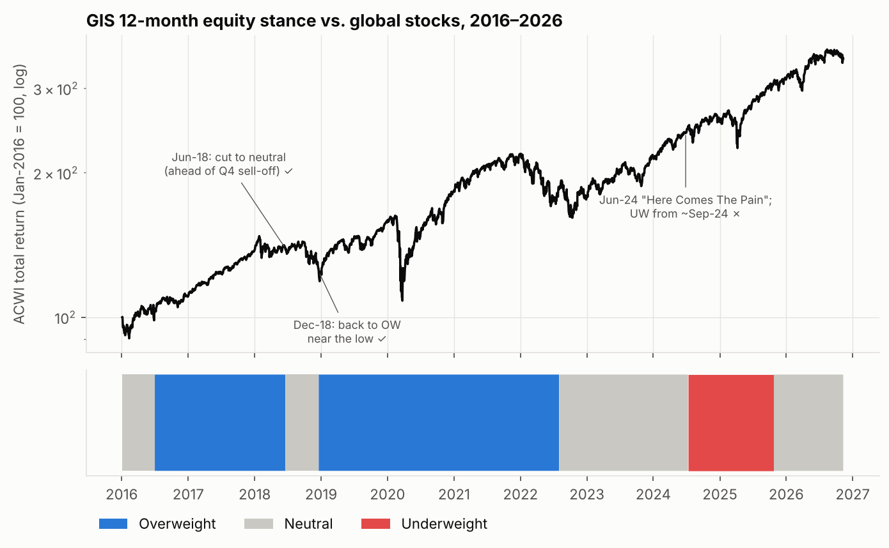
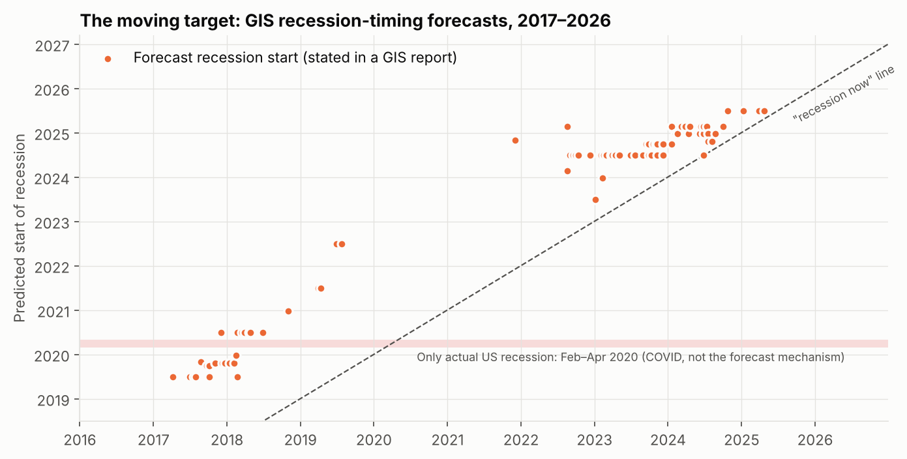
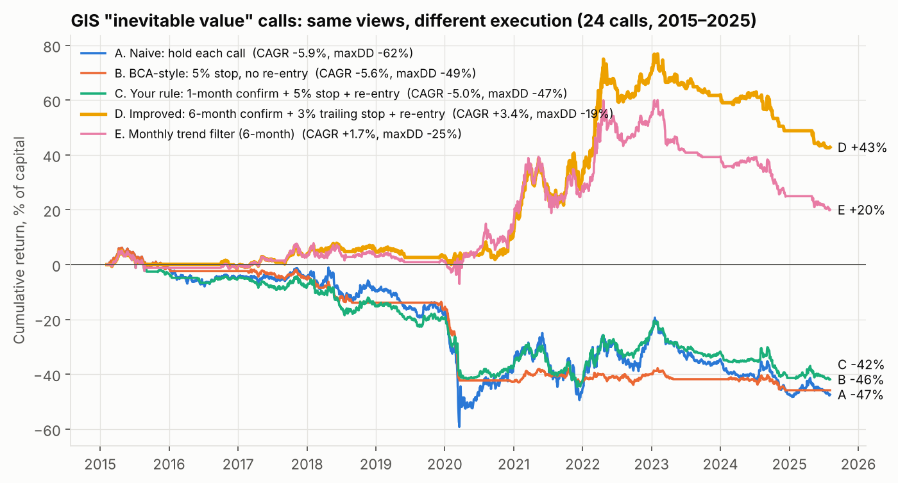
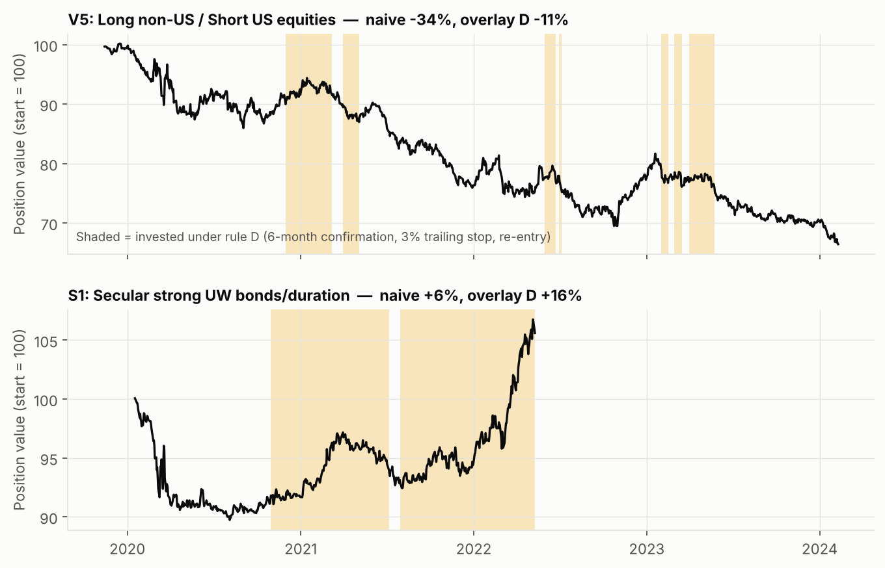
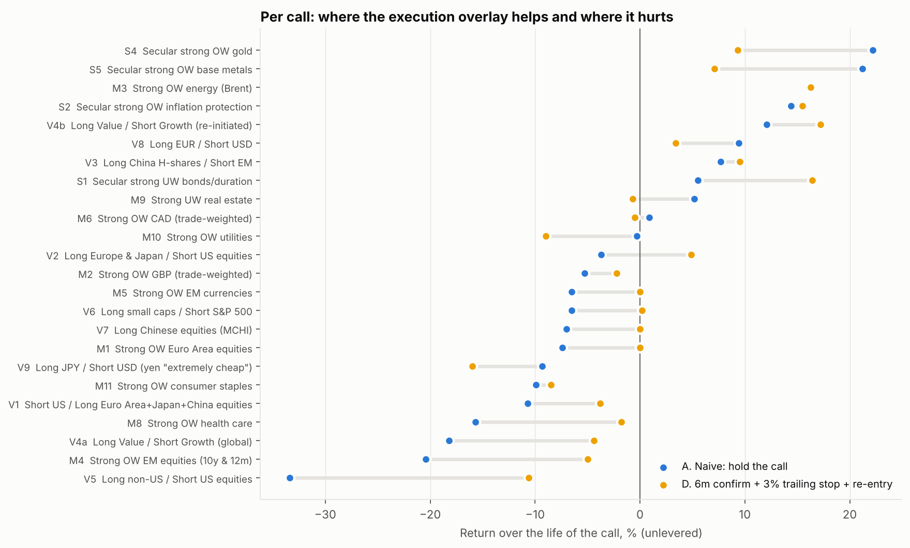
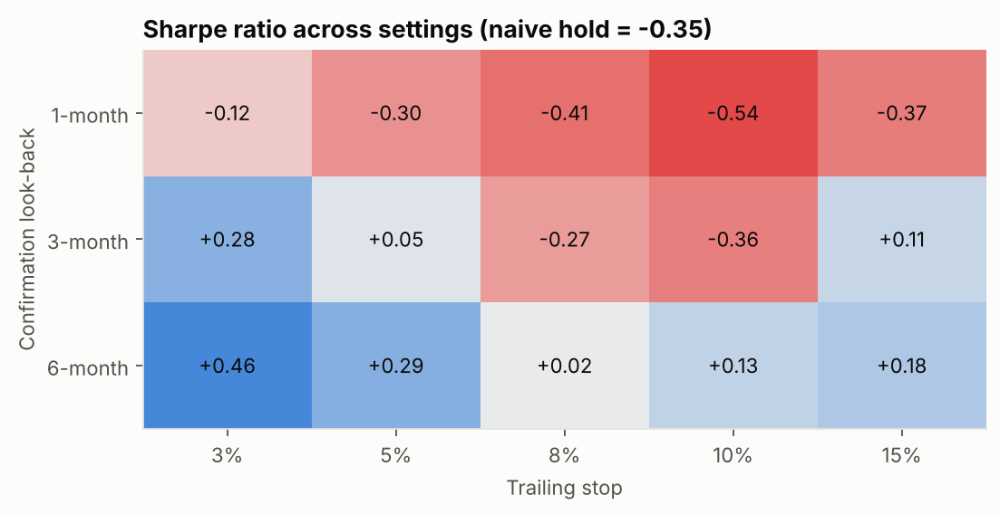

# BCA Research – Global Investment Strategy (GIS) retrospective

Do the GIS team's trades and macro calls add value? This repo pulls the whole GIS archive available on
bcaresearch.com, extracts every trade and every View Matrix rating, reprices them against market data, and
turns them into portfolios.

*Data as of 10 Nov 2026. Market data comes from Yahoo Finance. BCA report text and PDFs are not in this
repo, only the facts derived from them (trade ledgers, ratings, dates).*

---

## TL;DR: what's worth using

| Use GIS for... | Evidence | Ignore / fade GIS on... | Evidence |
|---|---|---|---|
| **Rates / duration direction** (12-month) | Hit rate 76%, rank-IC +0.51. Called the 2020–22 bond bear market | **Regional equity allocation** (anti-US, pro-EM/Europe) | Hit rate 38%, IC −0.23, **−1.2%/yr** as an overlay. SPY beat ACWI by ~30 pp while GIS was underweight the US |
| **Commodity tilts** (energy, metals, gold) | **+1.9%/yr**, information ratio 0.8. The best overlay | **Recession timing** | 87 dated forecasts, and the date was pushed back every time (2019→2020→2021→2022, then H2-2024→2025). No forecast recession arrived |
| **Contrarian "no recession" calls** | 2022–23: rejected the consensus recession view, which was correct | **3-month tactical views** | Zero or negative IC in every asset class. Tactical asset allocation lost **0.7%/yr** |
| **Cheap convex hedges when they're bearish** | Long SPY put: **+536%**, closed 7 Apr 2025, one day before the low | **Underweighting equities on a recession call** | Since the Jun-2024 "Here Comes The Pain" outlook: S&P +38%, ACWI +43% |
| **Self-reported trade P&L** (it's honest) | 17/18 repriced trades agree in sign. Median gap 1.3 pp | **The headline trade stats** | "Avg 10.2%, cumulative 580%" leaves out the losing open book that was dropped in Apr-2020 |

**Bottom line.** GIS's *rates and commodity* logic carries real signal. Its *equity-region*, *USD* and
*recession-timing* logic doesn't, and some of it has a consistent negative edge you could fade. The trade
book had real alpha in 2015–2016, which faded to roughly zero from 2018 onward. The newest product
(FullView Portfolio) was **−0.83 pp behind its benchmark** at the last published update (18 Jun 2026).

---

## 1. What was available (and what wasn't)

* **445 GIS ("CoreMacro → Global") reports, Dec 2015 → Nov 2026.** All are authored by Peter Berezin. 423
  have PDFs.
* **Nothing before Dec 2015 is on the current platform.** Site search returns nothing before 2016, and
  node IDs below the 2016 import block return 404. So **the Chen Zhao era (2008–2015) can't be reviewed
  directly.** The only view into it is a handful of long-running *strategic* positions opened in 2009–14
  that were still open in the 2015–16 tables (see §2.4). These are survivors, so they're biased toward
  winners.
* GIS published its calls in three different formats over time:

| Period | Format | Extracted |
|---|---|---|
| 2015 → Mar 2020 | Tactical Trades, Strategic Recommendations and a **cumulative closed-trade table** with realized P&L | 62 closed trades, plus 15 positions still open at 27 Mar 2020 |
| Apr 2020 → Dec 2020 | *No trade table.* On 9 Apr 2020 GIS switched to the View Matrix and promised to *"track all the positions in the matrix versus an appropriate market benchmark"*. That scorecard was **never published** | – |
| Dec 2020 → May 2025 | "Special Trade Recommendations" (open trades only, with return-to-date) | 34 trades. Closing values are the last mark before removal, or BCA's trade-tracker final |
| Dec 2019 → Jul 2025 | **View Matrix**: 1–5 ratings for ~32 assets at 3-month / 12-month / 10-year horizons. Graphical format from 2024 | 138 numeric and 37 graphical matrices, ≈15,000 ratings |
| Sep 2025 → 2026 | FullView Portfolio and its overlay trades (website trade tracker) | 55 trades with real dates taken from the comments. The tracker's own start/close dates are placeholders |

---

## 2. The trades

### 2.1 Summary statistics

Returns are per trade, as published (equal weight per trade). Trades quoted in bps are counted in the hit
rate only.

| Group | n | Hit rate | Mean | Median | Avg win | Avg loss | Profit factor |
|---|---|---|---|---|---|---|---|
| 2015–19 closed only (BCA's own table) | 62 | 56.5% | +10.1% | +5.3% | +21.7% | −5.9% | 5.1 |
| **2015–19 including open book at Mar-2020 marks** | 77 | **50.6%** | **+7.7%** | **+2.5%** | +20.5% | −7.1% | 3.4 |
| of which Tactical | 41 | 46% | +3.9% | −1.8% | +13.8% | −4.9% | 2.5 |
| of which Strategic (multi-year) | 36 | 56% | +11.8% | +4.2% | +26.1% | −10.2% | 3.9 |
| 2015–19 FX | 21 | **67%** | +10.4% | +3.9% | | | **6.8** |
| 2015–19 Rates/credit | 20 | 50% | +8.6% | +5.8% | | | 5.0 |
| 2015–19 Equities | 30 | **40%** | +2.2% | −2.2% | | | 1.4 |
| 2020–25 Special trades | 34 | 41% | +14.7% | −5.0% | | | 3.5 |
| 2020–25 excluding the SPY put | 31 | 42% | **−2.2%** | −5.0% | | | |
| 2025–26 FullView-era overlays | 55 | 51% | −1.6% | +0.1% | +6.5% | −10.1% | **0.67** |

**What this shows:**

* **Stop discipline is real.** Losses cluster at exactly −5% or −10%. The positive mean comes from a few
  large winners: Long S&P/Short WTI +126.5%, H-shares +50%, Aus/NZ bonds +60–74%, the SPY put +536%.
* **Survivorship in the headline.** Fifteen strategic positions were still open on 27 Mar 2020, most of
  them losing: Value/Growth −20.1%, EM −13.0%, Autos −13.4%, RUB −16.6%, TIPS breakevens −12.3%,
  Eurodollar −127 bps, CPI swaps −54/−65 bps. **They disappeared on 9 Apr 2020 without a reported exit.**
  Including them cuts the median trade from +5.3% to +2.5%.
* **"Cumulative return 580%"** compounds every trade as if each one used 100% of capital in sequence. It
  isn't a portfolio return.

### 2.2 Are BCA's numbers honest? Yes

I repriced 18 trades independently with Yahoo prices (`scripts/verify.py`): **17 of 18 agree in sign,
with a median absolute gap of 1.3 pp.** The gaps come from FX carry (BCA includes it), futures roll, and
intraperiod stops. In the one sign mismatch (Long S&P/Short HY, Feb-2018) the stop triggered during
"Volmageddon" before the market recovered.

### 2.3 A portfolio built from the trades

Construction rule: each trade gets 5% notional, and P&L accrues linearly from open to close. The option
is sized at 1% of capital in premium.



| | 2015 | 2016 | 2017 | 2018 | 2019 | 2020 | 2021 | 2022 | 2023 | 2024 |
|---|---|---|---|---|---|---|---|---|---|---|
| Overlay P&L, % of capital | +6.7 | +5.1 | +1.9 | +0.4 | −1.7 | −0.7 | −1.1 | −0.3 | +0.5 | +0.7 |
| Avg open positions | 13.6 | 12.7 | 11.1 | 12.2 | 12.7 | 2.9 | 3.1 | 7.5 | 4.4 | 5.2 |

**The edge decayed.** About +13.7% came in 2015–17, and most of it was carried by legacy multi-year
positions. From 2018 to 2024 the overlay totalled about −2%. For the FullView era, BCA's own table shows
overlay trades contributing **−0.34 pp** from Oct-2025 to Jun-2026.

### 2.4 The pre-2016 legacy positions (the only view of the Zhao-era book)

| Opened | Position | Closed | Result |
|---|---|---|---|
| Jan 2009 | Overweight Australia / New Zealand gov't bonds (hedged) | Jul 2017 | +59.5% / +74.2% vs benchmark |
| Aug 2012 | Long Italian 10-year bonds (at 5.88%) | Jul 2015 | +30.5% |
| Jul 2013 | Long Bunds / Short JGBs | Feb 2015 | +13.5% |
| Oct 2013 | Long S&P 500 / Short WTI | Feb 2015 | **+126.5%** |
| Nov 2013 | Underweight commodity-producer equities | May 2015 | +19.2% |
| Feb 2014 | US 30y vs 10y flattener | Jul 2016 | +22.5% |
| May 2014 | Long China H-shares | Jul 2015 | +50.0% |
| Oct 2014 | Long US dollar (DXY) | Apr 2019 | +16.4% |

These all follow the 2009–14 macro thesis: global disinflation, low yields for longer, a strong dollar and
a commodity bust. That thesis was right. Only survivors are visible, though, so this isn't a full track
record for the era.

### 2.5 FullView Portfolio (launched 24 Oct 2025): BCA's own reported scorecard

| Date | vs benchmark (60% equity, 25% TLT, 15% BIL) |
|---|---|
| 8 Jan 2026 | +102 bps |
| 12 Feb 2026 | +171 bps |
| 26 Feb 2026 | +181 bps |
| 27 Mar 2026 | +66 bps |
| **18 Jun 2026** | **−83 bps** (portfolio +8.41% vs benchmark +9.24%; asset allocation −0.49, overlays −0.34) |

The reports stopped mentioning outperformance once the gap turned negative. No later figure appears in the
GIS reports through Nov 2026. The largest single loss was Long copper / Short oil, **−52% in 10 days**
(Mar 2026, 1.5% weight).

---

## 3. The macro views (View Matrix, Dec 2019 → Jul 2025)

### 3.1 Do the ratings predict returns?

Each weekly rating (1 = strong underweight … 5 = strong overweight) is compared with the asset's forward
return relative to its benchmark: 63 trading days for 3-month views and 252 for 12-month views. *IC* is the
rank correlation between rating and forward return.

| Horizon | Category | Active calls | Hit rate | OW − UW fwd return | IC |
|---|---|---|---|---|---|
| 12-month | **Fixed income** (duration, gov't, IG, HY, linkers) | 559 | **68%** | +5.2 pp | **+0.42** |
| 12-month | **Commodities** | 337 | 58% | +15.1 pp | **+0.25** |
| 12-month | Equity / bond / cash allocation | 274 | 55% | +5.8 pp | +0.17 |
| 12-month | Currencies | 1038 | 54% | +0.3 pp | −0.03 |
| 12-month | **Regional equities** | 932 | **38%** | **−5.3 pp** | **−0.23** |
| 12-month | Equity sectors (2024–25) | 239 | 39% | −6.9 pp | −0.18 |
| 3-month | *All categories* | | 38–53% | ≈ 0 or negative | −0.20 … +0.03 |

Single calls at the 12-month horizon:
**Duration** hit 76% (IC +0.51) · **US equities** hit **19%** (IC −0.54) · **EM equities** hit **16%**
(IC −0.46) · **USD** hit 37% (IC −0.28) · Gold 54%.

### 3.2 A portfolio built from the matrix

Rules:
* Asset allocation: 60/40 (ACWI / AGG+BNDX), ±10 pp per rating notch. Cash rating adds T-bills.
* Overlays: long/short, 5% notional per notch against the benchmark. Duration overlay is 25% per notch in
  IEF vs BIL.
* Rebalanced at every report. Each signal applies from the next trading day.



| Component (12-month views) | Annualized active return | Info ratio | Component (3-month views) | Annualized |
|---|---|---|---|---|
| Equity / bond / cash vs 60/40 | +0.23% | 0.13 | Equity / bond / cash | **−0.72%** |
| Regional equity tilts | **−1.17%** | −0.57 | Regional equity tilts | −1.33% |
| Duration | +0.36% | 0.22 | Duration | +0.44% |
| Currencies | +0.03% | 0.02 | Currencies | −0.42% |
| **Commodities** | **+1.93%** | **0.81** | Commodities | +0.63% |
| Sectors (2024–25 only) | −1.07% | −0.68 | Sectors | −1.45% |

By asset, the biggest contributors were energy (+0.9%/yr), base metals (+0.7%) and gold (+0.3%). The
biggest detractors were EM overweight (−0.4%), Euro Area overweight (−0.3%) and the health-care and
staples sector overweights.

### 3.3 The big narrative calls



| Call | Verdict |
|---|---|
| 2016–17 "cyclically bullish" on risk assets | ✅ ACWI +8% (2016), +24% (2017) |
| **20 Jun 2018: cut equities to neutral ("Three Policy Puts Go Kaput")** | ✅ Ahead of the Q4-2018 sell-off |
| **19 Dec 2018: back to overweight near the low** | ✅ ACWI +27% in 2019. Their best equity-timing call |
| 2017–19: "recession in late 2019 … 2020 … 2021 … 2022" | ❌ Timing kept rolling forward. The 2020 recession was the pandemic, not the forecast mechanism |
| 2020–22: overweight stocks, underweight bonds and duration | ✅ Stocks up in 2020–21 (still overweight into H1-2022). **Bond bear market in 2021–22 caught** |
| 2020–25: underweight US, overweight EM / Europe | ❌ US kept leading. ~30 pp of underperformance vs ACWI |
| 2020–23: bearish USD | ⚠️ Right in 2020 and 2023, wrong in 2021–22 (DXY +6%, +8%) |
| **2022–23: "no recession", against consensus** (kinked-Phillips-curve, immaculate disinflation) | ✅ Correct and contrarian. The best *macro* insight, but equities were only held at neutral in 2023 |
| 2023–25: "recession in H2-2024" → "late-24/early-25" → "75% in 2025" | ❌ None arrived. Underweight equities from ~Sep 2024; ACWI +40% since |
| Nov-2024 SPY put as a bearish hedge | ✅ +536%, closed 7 Apr 2025 |



**The recession-forecasting framework** (labour-market and Phillips-curve logic, "recession starts just as
everyone declares a soft landing") produced a forecast that was always 12–18 months out, and the date
moved each year. It's useful as a list of risks. It doesn't work as a timing tool.

---

## 4. How to take advantage of this

1. **Follow GIS on rates and duration (12-month) and on commodity tilts.** Those are where the ratings had
   positive IC and positive overlay P&L. Use them as inputs to sizing, not as automatic switches.
2. **Treat GIS regional-equity views (especially "underweight US") as a contrarian or at best neutral
   signal.** The hit rate was below 20% on US and EM, a structural bias. Don't follow it.
3. **Don't trade GIS's 3-month tactical calls.** IC was zero or negative in every asset class.
4. **When GIS turns bearish, buy cheap convexity instead of cutting equity weight.** The SPY put made
   +536%, while the equity underweight cost about 40 pp of upside.
5. **Read their "no recession" calls more closely than their "recession coming" calls.** The contrarian
   soft-landing call in 2022–23 was right. Every dated recession call was wrong on timing.
6. **Use the trade ideas for idea generation, sized small.** Expect about 50% winners, losses stopped at
   −5% or −10%, and returns coming from a few fat-tail winners. Most of the edge was in 2015–17.
7. **Track them yourself.** The FullView table is their only live scorecard; check it in each report. Ask
   BCA for the matrix scorecard they promised in April 2020.
8. **Don't act on a GIS "value" call when it's published. Wait until the price confirms it** (see §5). On
   GIS's own conviction calls, the same views went from −5.9%/yr to +3.4%/yr this way.

---

## 5. Execution overlay on GIS's conviction ("inevitable value") calls

**Question.** GIS's highest-conviction calls usually rest on valuation: "cheap", "X% below PPP", "an
irresistible valuation tailwind". Can a simple execution rule turn those views into a better strategy?
The rule: enter only after the price confirms, then use a stop-loss, then re-enter.

### 5.1 The call universe (fixed before any backtest; `data/value_calls.json`)

GIS never uses the word "inevitable" for its investment calls; it reserves it for macro events like
recessions or the US–China conflict. So the universe is defined objectively as GIS's **highest-conviction
calls**: 24 in total, Feb 2015 → Aug 2025.

* **Valuation-justified trades (V1–V9).** Each one's rationale is confirmed in GIS's own text:

  | Call | Period | GIS rationale |
  |---|---|---|
  | Short US / long Euro Area + Japan + China | 2015–17 | |
  | Long Europe & Japan / short US | 2017–18 | |
  | Long China H-shares / short EM | 2017–20 | *"a substantial discount"* |
  | Long value / short growth | 2018–20 and 2020–23 | |
  | Long non-US / short US | 2019–24 | *"an increasingly irresistible valuation tailwind"* |
  | Long small caps | 2022–23 | *"relatively cheap"* |
  | Long China | 2022 | |
  | Long EUR | 2022–23 | *"26% undervalued based on PPP"* |
  | Long JPY | 2022–25 | *"extremely cheap … 40% below PPP"* |

* **Every strongest 12-month View Matrix rating (1 or 5)** (M1–M11):
  * Euro Area equities, GBP, energy
  * EM equities, EM FX, CAD
  * Health care, utilities, staples
  * Short real estate
* **Every strongest 10-year ("secular value") rating** (S1–S5):
  * Short bonds/duration
  * Long inflation protection
  * Gold, base metals
  * EM equities (merged with the 12-month EM call)

Instruments:
* Pairs are long/short total-return ETFs. Currency-hedged legs use HEZU and HEWJ.
* Outright positions are measured as excess return over T-bills.
* JPY includes the negative carry.

Each call runs from GIS's start date to the date GIS dropped or changed it. Positions are sized to 5%
annual volatility at each entry.

### 5.2 Rules tested

| | Strategy | Entry | Exit | Re-entry |
|---|---|---|---|---|
| A | **Naive**: follow GIS | On the call date | When GIS ends the call | – |
| B | BCA-style stop | On the call date | 5% stop | Never |
| C | **Your rule**: 1-month confirmation + stop + re-entry | Month-end close where the position gained over that month | 5% stop (daily close) or call end | Next month-end with a positive month |
| D | **Improved**: 6-month confirmation + trailing stop + re-entry | Month-end where the position gained over the last 6 months | Position falls 3% below its peak since entry, or call end | Next month-end with positive 6-month momentum |
| E | Monthly trend filter | In while the 6-month return is positive | Out when it turns negative | Monthly |

Decisions are made at a close and applied from the next day, so there is no look-ahead.

### 5.3 Results: portfolio of all 24 calls, Feb 2015 → Aug 2025



| Strategy | CAGR | Vol | Sharpe | Max DD | Entries | Winning entries |
|---|---|---|---|---|---|---|
| A. Naive: follow GIS's conviction calls | **−5.9%** | 16.7% | −0.35 | **−62%** | 24 | 42% |
| B. BCA-style 5% stop, no re-entry | −5.6% | 6.1% | −0.92 | −49% | 24 | 17% |
| C. Your rule: 1m confirm + 5% stop + re-entry | −5.0% | 9.8% | −0.51 | −47% | 50 | 22% |
| **D. 6m confirm + 3% trailing stop + re-entry** | **+3.4%** | 7.4% | **+0.46** | **−19%** | 95 | 40% |
| E. Monthly trend filter (6m) | +1.7% | 8.7% | +0.20 | −25% | 44 | 39% |

Calendar years, % of capital:

| | 2015 | 2016 | 2017 | 2018 | 2019 | 2020 | 2021 | 2022 | 2023 | 2024 | 2025* |
|---|---|---|---|---|---|---|---|---|---|---|---|
| A. Naive | −1.3 | −3.4 | −0.8 | −4.5 | −9.0 | **−23.8** | −12.8 | +36.3 | −12.2 | −19.2 | −0.5 |
| D. 6m confirm + 3% trail | +0.1 | −0.9 | +4.0 | +1.7 | −1.9 | **+8.7** | +19.0 | +27.5 | −4.8 | −8.0 | −4.1 |

\*2025 runs to Aug.

**What this shows:**
* **Followed as published, GIS's conviction "value" calls lost money.** Most were value traps: cheap
  assets that kept getting cheaper for years. Non-US vs US lost 33%, EM vs world 20%, value vs growth 18%,
  health care 16%, the yen 9%.
* **Your 1-month rule (C) barely helps.** One good month is too noisy a signal. The rule keeps
  re-entering persistent losers: non-US vs US was entered nine times.
* **Waiting for 6 months of confirmation (D) is what works.** It sits out the long "value trap" phases and
  catches the trends once they start, as chart 8 shows. Examples: shorting bonds only from late 2020, and
  the 2021–22 value, commodity and inflation trades.
* **It is still a trend-following payoff.** Only 40% of entries win; there are many small stop-outs and a
  few big trends. **The profit is concentrated in 2020–22.** In 2023–25 rule D lost money too, though much
  less than naive. A trending macro regime is what makes it work.



### 5.4 Per call



**Where D helps most:**
* Non-US vs US: −33% → −11%
* EM: −20% → −5%
* Value vs growth (2018–20): −18% → −4%
* Health care: −16% → −2%
* Short bonds: +6% → +16%
* Europe/Japan vs US: −4% → +5%

**Where D hurts:**
* The yen: −9% → −16%, whipsawed by sharp short-covering rallies
* Gold and base metals: give up part of the trend, +22% → +9% and +21% → +7%
* Utilities: −0% → −9%

### 5.5 Robustness: is D just the best cell of the grid?

D was chosen *after* looking at the grid, so the checks below matter. The grid covers 66 configurations:
confirmation look-back of 1, 3 or 6 months × threshold of 0% or 2% × stop of 3–15% (fixed or trailing),
plus the trend filter.



* **All 66 configurations beat naive holding.** 53% of them have a positive CAGR.
* **Look-back is the main driver, and the pattern is monotonic.** Median CAGR is −2.6% (1 month), −0.1%
  (3 months) and **+1.9% (6 months)**. Tighter stops work better than wide ones.
* **Time split.** The same 6-month rule improves both halves of the sample:

  | Calls started | Naive CAGR | 6m rule CAGR (5% trailing stop) | Naive max DD | 6m rule max DD |
  |---|---|---|---|---|
  | 2015–19 | −7.1% | −1.1% | −51% | −14% |
  | 2020–25 | +0.8% | **+6.6%** (Sharpe 0.63) | | |

* **Broader test: all 66 twelve-month View Matrix call windows, 2019–25** (it partly overlaps the 24
  conviction calls). The overlay improves
  all of them as well.
  * With equal 5% notional per call: Sharpe rises from 0.14 to **0.42–0.49** and max drawdown halves
    (−12.5% → −5–7%).
  * With vol-targeted sizing: −7.8% → between −1.9% and +1.4% CAGR.
  * Here even the 1-month rule works (Sharpe 0.49), so the *exact* look-back matters less than *having
    a confirmation rule at all*.

**How to use this.** Treat a new GIS conviction or "cheap asset" call as a **watchlist entry, not a trade**:
1. Buy only once the position shows a positive 6-month return at a month-end close.
2. Protect it with a tight trailing stop, about 3% from the peak on the position.
3. Re-enter on the next positive 6-month reading while GIS still holds the view.
4. Exit when GIS drops the view.

Expect about 40% winning entries, and expect the strategy to do best in trending macro regimes. Even with
this filter, GIS's equity-region calls (non-US, EM) still lost money; the overlay just made the losses
smaller.

---

## 6. Method, assumptions and caveats

* **Small sample.** The matrix test covers 5.6 years. Weekly observations overlap heavily, so there are
  only about 5–6 independent 12-month windows per asset. A few regimes dominate the results (2022 rates,
  2021–22 energy, US tech leadership). Treat the ICs as directional evidence, not statistical proof.
* **Proxies:**
  * Equities: ACWI, SPY, EZU, EWU, EWC, EWA, EWJ, EEM.
  * Global aggregate (hedged): 50/50 AGG + BNDX.
  * Fixed-income sectors: GOVT, LQD, HYG, TIP vs AGG/IEF.
  * Duration: IEF vs BIL.
  * Currencies (trade-weighted): each G7 currency vs an equal-weight basket of the other six. EM
    currencies: CEW.
  * Commodities: Brent front-month (roll ignored), DBB, GLD.
  * Sectors: iShares global sector ETFs vs ACWI.
* **Trade sizing:**
  * 5% notional per trade, linear P&L accrual over the holding period.
  * Bps-quoted trades (Fed funds, Eurodollar, CPI swaps) count toward hit rates but not toward % P&L. Net
    they were −362 bps across ten trades.
* **Closing values:**
  * 2020–25 special trades close at their last published mark, or at the final value on BCA's trade
    tracker.
  * Open positions dropped in April 2020 are valued at their 27 Mar 2020 marks, which was close to the
    COVID low.
* **Equity stance before 2020** (chart 1) is reconstructed from report text, so its dates are approximate.
  From 2020 the stance comes from the matrix.
* **Graphical matrix (2024–25):** read from the filled squares in the PDF vector graphics. Validated
  visually on sample pages.
* **Numeric matrix:** struck-through old ratings are detected and dropped. 0 ambiguous cells.

---

## 7. Reproducing

```bash
pip install -r requirements.txt
```

Set `BCA_USER` (your BCA login email) and `BCA_Pass` in the environment. Then run from a working
directory. Downloads go to `raw/`, `pdf/`, `pdftxt/`, `txt/`, `web/` and `px/`; these are git-ignored and
must never be committed.

```bash
python scripts/bca_login.py web/cookies.pkl          # Auth0 + SAML login, saves session cookies
python scripts/list_reports.py '{"platform_category":"216976","platform_strategist":"291"}' web/berezin_global.json
python scripts/download.py web/berezin_global.json raw   # report HTML
python scripts/pdf_dl.py web/berezin_global.json pdf     # report PDFs (trade tables / matrices live here)
python scripts/build_index.py                            # PDF->text, HTML->text, index
python scripts/parse_ledger.py pdftxt/166486.json 27,28 data/closed_2015_2019.json
python scripts/lifecycle.py                              # every open-position snapshot 2016-2025
python scripts/parse_vm.py web/vm_reports.json data/vm_numeric_raw.json
python scripts/parse_vm_graph.py web/vm_graph_reports.json data/vm_graph_raw.json
python scripts/vm_timeline.py && python scripts/build_trades.py
python scripts/trade_stats.py && python scripts/trade_portfolio.py && python scripts/verify.py
python scripts/vm_eval.py && python scripts/vm_portfolio.py
python scripts/recession_calls.py && python scripts/charts.py
# Section 5: execution overlay on conviction calls (data/value_calls.json is the pre-registered universe)
python scripts/overlay_report.py                         # strategies A-E on the 24 conviction calls
python scripts/overlay_grid.py data/value_calls.json data/overlay_grid.csv   # 66-config robustness grid
python scripts/overlay_matrix.py                         # same rules on all 12m matrix calls (needs data/matrix_calls_12m.json)
python scripts/overlay_charts.py
```

### Data files (`data/`)

| File | Content |
|---|---|
| `closed_2015_2019.json` | 62 closed trades with BCA-reported realized P&L |
| `lifecycle.json` | Every trade position seen in any weekly table, with its return-to-date path |
| `all_trades.csv` | Unified ledger (166 trades, all eras), used for all trade statistics |
| `website_trades_berezin.json` | BCA trade-tracker rows for Berezin (facts only, commentary removed) |
| `vm_ratings_long.csv` | Every View Matrix rating: date × asset × horizon |
| `vm_eval_obs.csv` | Ratings joined to forward relative returns |
| `vm_portfolio_curves.csv` | Daily returns of the matrix-based portfolios |
| `recession_calls.csv` | 87 dated recession-timing statements and the implied start date |
| `report_index.json` | All 445 reports: date, slug, which PDF pages hold trade tables |
| `value_calls.json` | The 24 conviction ("inevitable value") calls: dates, legs, rationale |
| `matrix_calls_12m.json` | All 66 non-neutral 12-month matrix call windows (out-of-universe test) |
| `overlay_summary.csv`, `overlay_value_daily.csv` | Strategies A–E: statistics and daily portfolio returns |
| `overlay_per_call.csv`, `overlay_per_call_table.csv`, `overlay_trades.csv` | Per-call results and every simulated entry/exit |
| `overlay_grid.csv`, `overlay_matrix_results.csv` | Robustness grid and broad-matrix results |
